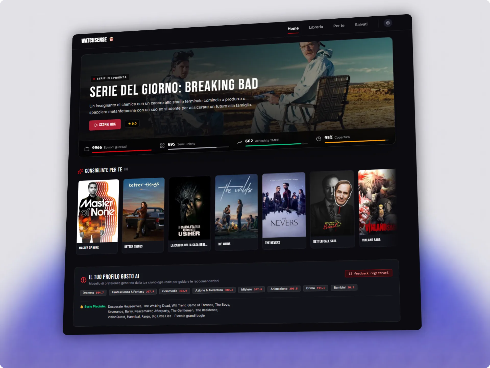
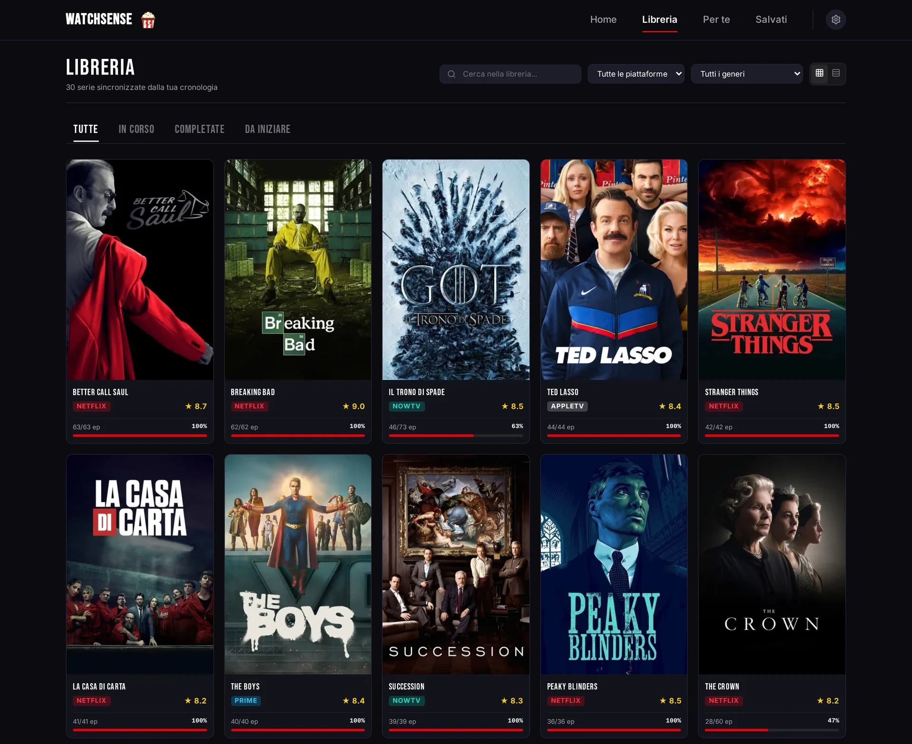
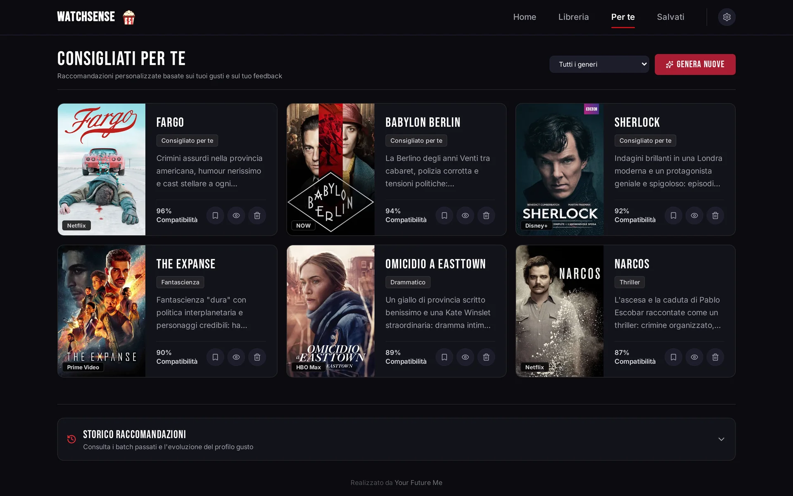
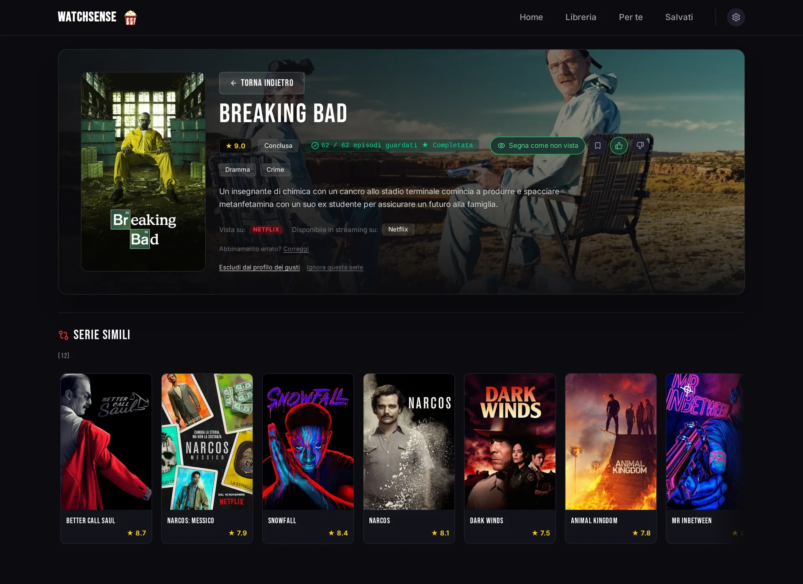

<p align="center"></p>

# WatchSense

🇮🇹 Italiano · [🇬🇧 English](README.md)

Raccomandazioni di serie TV self-hosted, basate sulla tua cronologia di visione e su un LLM a tua scelta.

WatchSense raccoglie ciò che hai visto su **Netflix, Prime Video, Stremio e Trakt**, lo arricchisce con i metadati di **TMDB** e chiede a un **LLM compatibile OpenAI** (cloud o locale) cosa guardare dopo. I tuoi feedback (👍/👎, serie completate o abbandonate, note sui gusti) vengono usati nelle raccomandazioni successive.

> **Lingue.** L'interfaccia è in inglese e in italiano. La lingua dell'app, la lingua dei metadati TMDB e la regione per la disponibilità streaming si impostano separatamente nelle Impostazioni (vedi [Lingua e regione](docs/CONFIGURATION.it.md#lingua-e-regione)); un'installazione nuova parte in inglese con la regione `US`, quelle già esistenti restano in italiano.

## Funzionalità

- **Import della cronologia** da Netflix (cookie di sessione con sync automatica, bookmarklet, CSV), Prime Video (bookmarklet, CSV), Stremio (sync dell'account) e Trakt (export dei dati). I film presenti nelle cronologie vengono registrati ma non mostrati né usati: WatchSense è pensato per le serie TV.
- **Arricchimento TMDB**: titoli e trame nella tua lingua, poster, generi, parole chiave e piattaforme streaming della tua regione.
- **Raccomandazioni LLM** da qualsiasi endpoint compatibile OpenAI (Kilo, OpenRouter, OpenAI, Groq, DeepSeek, Mistral, Ollama, LM Studio, ...), con preset nella pagina Impostazioni.
- **Ciclo di feedback**: voti, stato delle serie e note libere sui gusti orientano i suggerimenti successivi.
- **Un solo file SQLite** per tutti i dati; gira come singolo processo Node.js o singolo container.

## Fonti supportate

| Fonte | Come |
| :--- | :--- |
| Netflix | cookie di sessione con sync automatica, bookmarklet, CSV |
| Prime Video | bookmarklet, CSV |
| Stremio | sync dell'account |
| Trakt | import una tantum dell'export dei dati |

Dettagli in [Metodi di sincronizzazione](docs/CONFIGURATION.it.md#metodi-di-sincronizzazione).

**Non supportati:** Disney+, Apple TV+, Paramount+, HBO Max e altri servizi. Molti non espongono affatto una cronologia di visione (in particolare Disney+ e Apple TV+). Le loro serie compaiono comunque nelle classifiche della Home e nelle raccomandazioni, perché le classifiche vengono dalle piattaforme streaming di TMDB.

Alternative per ora:

- Segna tu una serie dalla sua pagina con **Segna come in corso** o **Segna come completata**.
- Se tieni già traccia su Trakt, importa il suo [export dei dati](docs/CONFIGURATION.it.md#trakt-export-dei-dati). Un modo per portare su Trakt la cronologia di più servizi è l'estensione per browser [Universal Trakt Scrobbler](https://github.com/trakt-tools/universal-trakt-scrobbler): è un progetto di terze parti, non affiliato a WatchSense, e WatchSense non l'ha testato.

Altre fonti dirette (ad esempio Jellyfin o Plex) potrebbero arrivare in futuro; i contributi sono benvenuti.

## Screenshot



La home è presa dall'istanza dell'autore. Gli altri screenshot sono catturati da un database demo in italiano con una cronologia di visione inventata (vedi [`ui/scripts/seed-demo.mjs`](ui/scripts/seed-demo.mjs)); le classifiche sono dati TMDB in tempo reale.

| Libreria | Per te (raccomandazioni) |
| --- | --- |
|  |  |



Per rigenerarli, crea un database demo e avvia l'app su quello (mai sul tuo `data/watchsense.db` reale):

```bash
cd ui
TMDB_API_KEY=... node scripts/seed-demo.mjs --locale it /tmp/watchsense-demo/watchsense.db   # --locale en per la demo in inglese
npm run build
DATABASE_PATH=/tmp/watchsense-demo/watchsense.db TMDB_API_KEY=... HOST=127.0.0.1 PORT=4400 node .output/server/index.mjs
```

## 🚀 Avvio rapido (Docker)

Richiede Docker con Compose, oppure Podman con `podman compose`.

```bash
git clone https://github.com/peppeg/watchsense.git
cd watchsense

cp .env.example .env
# Modifica .env: imposta TMDB_API_KEY e un provider LLM (LLM_BASE_URL / LLM_API_KEY / LLM_MODEL),
# oppure impostali dopo nelle Impostazioni

docker compose up -d      # oppure: podman compose up -d
```

Apri `http://localhost:3000` (la porta sull'host segue `PORT` in `.env`). Il database viene creato in `./data/` al primo avvio; gli export Trakt vanno in `./exports/`.

Al primo avvio la Home mostra la lista **Per iniziare**: lingua e paese, chiave TMDB, una fonte di visione e il modello AI, ognuno con il collegamento diretto alla sezione giusta delle Impostazioni.

## Sviluppo locale

```bash
cd ui
npm install
npm run dev               # http://localhost:3333
```

Il server carica anche il `.env` nella radice all'avvio (vedi sotto), quindi `nuxt dev` usa le stesse variabili; `ui/.env`, se presente, ha la precedenza.

## Produzione senza Docker

Richiede Node.js 22 (più una toolchain C/C++ se `better-sqlite3` deve essere compilato).

```bash
cd ui
npm ci
npm run build
PORT=3000 HOST=0.0.0.0 DATABASE_PATH=../data/watchsense.db \
TMDB_API_KEY=... LLM_BASE_URL=... LLM_API_KEY=... LLM_MODEL=... \
node .output/server/index.mjs
```

All'avvio il server carica il `.env` nella radice del progetto (la cartella con `db/schema.sql`), se il file esiste. Le variabili già presenti nell'ambiente non vengono mai sovrascritte, quindi riga di comando, systemd o Docker hanno sempre la precedenza. Un esempio di unit systemd utente è nella [guida alla configurazione](docs/CONFIGURATION.it.md#avvio-come-servizio-systemd-utente).

## Configurazione

Vedi **[docs/CONFIGURATION.it.md](docs/CONFIGURATION.it.md)**:

- [Chiave API TMDB](docs/CONFIGURATION.it.md#tmdb)
- [Provider LLM e preset](docs/CONFIGURATION.it.md#provider-llm)
- [Metodi di sincronizzazione](docs/CONFIGURATION.it.md#metodi-di-sincronizzazione): cookie Netflix, bookmarklet, Stremio, Trakt, CSV
- [Accesso e sicurezza](docs/CONFIGURATION.it.md#accesso-e-sicurezza)
- [Variabili d'ambiente](docs/CONFIGURATION.it.md#variabili-dambiente)
- [Backup e ripristino](docs/CONFIGURATION.it.md#backup-e-ripristino)

## 🔒 Sicurezza

- **L'autenticazione è disattivata di default.** Senza `WATCHSENSE_TOKEN` chiunque raggiunga la porta può leggere la tua cronologia, cambiare le impostazioni e avviare chiamate LLM addebitate sulla tua chiave API.
- **In una rete privata** (LAN fidata, Tailscale, WireGuard) di solito va bene. Altrimenti imposta `WATCHSENSE_TOKEN` (schermata di accesso + `Authorization: Bearer`) **e** servilo in HTTPS tramite un reverse proxy; `HOST=127.0.0.1` lo limita al computer locale. Vedi [Accesso e sicurezza](docs/CONFIGURATION.it.md#accesso-e-sicurezza).
- Le richieste API che modificano dati vengono rifiutate se arrivano da un'altra origine o hanno un body non JSON (eccezioni: l'upload CSV e l'endpoint del bookmarklet, che richiede il token dell'istanza).
- I cookie di sessione Netflix, l'authKey Stremio, le chiavi API salvate dalla UI e il token del bookmarklet sono **cifrati** nel database SQLite (AES-256-GCM) con una chiave tenuta fuori dal database: `data/secret.key`, creato al primo avvio, oppure `WATCHSENSE_SECRET_KEY`. **Fai un backup separato della chiave**: il solo database non rivela i segreti e senza la chiave vanno reinseriti. Chi ha accesso completo al server può comunque leggere entrambi. Vedi [Segreti salvati](docs/CONFIGURATION.it.md#segreti-salvati).
- Per segnalare una vulnerabilità in privato vedi [SECURITY.md](SECURITY.md) (in inglese).

## Privacy

- Cronologia, feedback e impostazioni stanno nel database SQLite locale. Non c'è telemetria.
- Per generare raccomandazioni e profilo gusti, i titoli visti, i feedback e le note sui gusti vengono **inviati al provider LLM che configuri**, salvo che tu usi un modello locale (Ollama, LM Studio, ...).
- Metadati, poster e disponibilità streaming vengono richiesti a TMDB.
- I metodi di sync contattano i rispettivi servizi (Netflix, Stremio) con le tue credenziali.

## Struttura del progetto

```text
watchsense/
├── Dockerfile               # immagine di produzione multi-stage (Node 22)
├── docker-compose.yml       # un servizio, volumi ./data e ./exports
├── .env.example             # modello delle variabili d'ambiente
├── db/schema.sql            # schema SQLite di base (migrazione v1)
├── ui/                      # app Nuxt 4 (UI Vue + server Nitro)
│   ├── app/                 # app.vue, componenti, stili
│   └── server/
│       ├── api/             # endpoint REST (sync, LLM, feedback, serie, config)
│       ├── db/              # migrazioni versionate dello schema
│       ├── middleware/      # controllo stessa origine / solo JSON per le richieste mutanti
│       ├── plugins/         # scheduler in background (sync Netflix e Stremio)
│       └── utils/           # helper per DB, TMDB, LLM e sync
├── data/                    # database SQLite (runtime, non versionato)
├── exports/                 # export Trakt (runtime, non versionato)
└── docs/                    # guida alla configurazione (EN/IT)
```

## Disclaimer

WatchSense è un progetto indipendente. Non è affiliato, approvato né sponsorizzato da Netflix, Amazon/Prime Video, Stremio, Trakt o TMDB. L'uso dei cookie di sessione e lo scraping della propria cronologia di visione possono violare i Termini di Servizio di questi servizi: fallo a tuo rischio e solo con i tuoi account.

## Attribuzione TMDB

This product uses the TMDB API but is not endorsed or certified by TMDB. (Questo prodotto usa le API TMDB ma non è approvato né certificato da TMDB.) Metadati e immagini sono forniti da [The Movie Database (TMDB)](https://www.themoviedb.org/).

## Ringraziamenti

Il caricamento della cronologia completa nel bookmarklet di Prime Video, e il formato CSV di Prime Video, vengono da [Watch History Exporter for Amazon Prime Video](https://github.com/twocaretcat/watch-history-exporter-for-amazon-prime-video) di John Goodliff ([@twocaretcat](https://github.com/twocaretcat)), in pubblico dominio (The Unlicense).

## Contribuire

I contributi sono benvenuti, comprese nuove fonti di visione: vedi [CONTRIBUTING.md](CONTRIBUTING.md) (in inglese).

## Crediti

Realizzato da [Your Future Me](https://yourfuture.me), studio di sviluppo web e AI.

## Licenza

[MIT](LICENSE)
