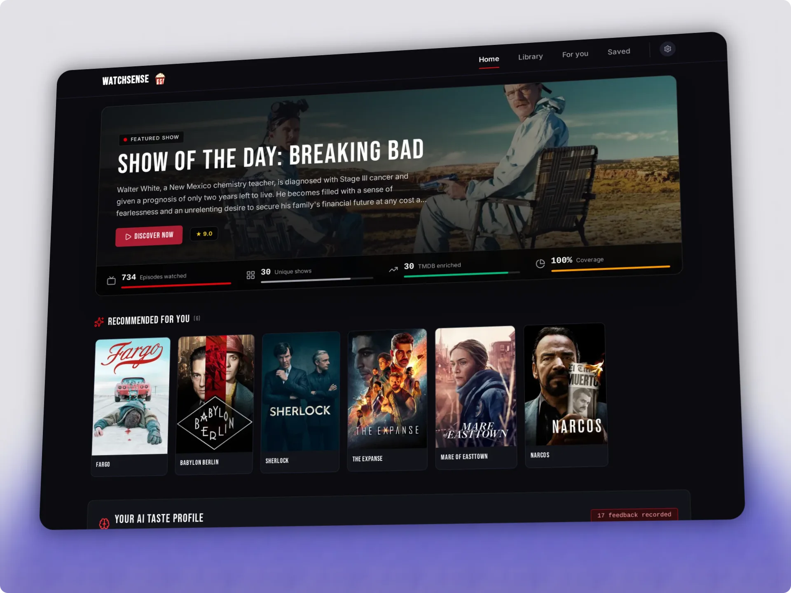
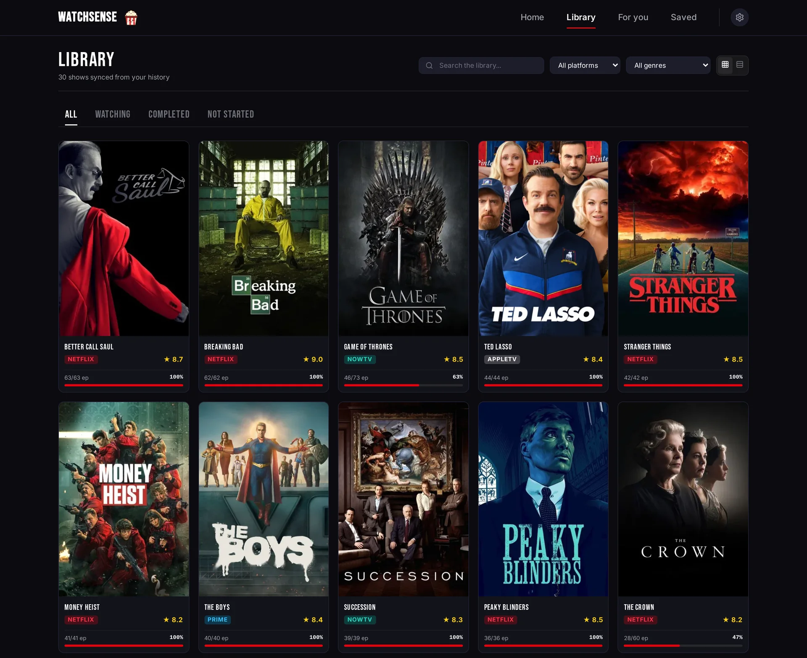
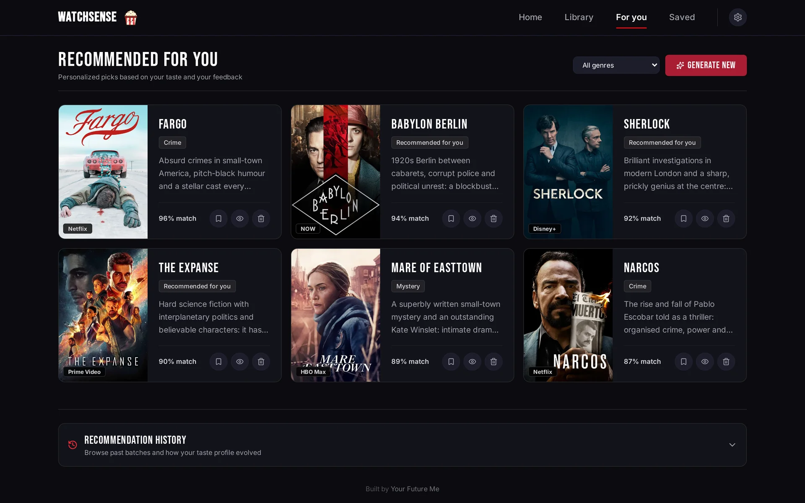
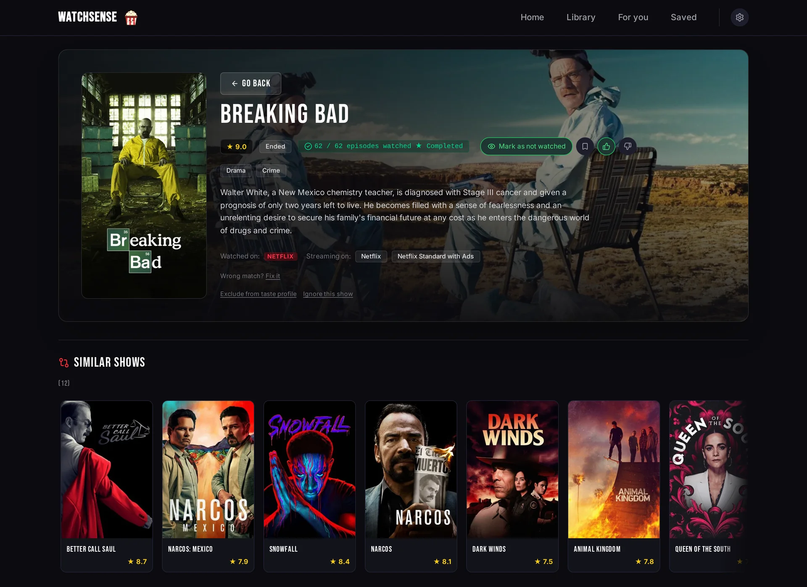

<p align="center"></p>

# WatchSense

[🇮🇹 Italiano](README.it.md) · 🇬🇧 English

Self-hosted TV series recommendations driven by your own viewing history and an LLM of your choice.

WatchSense collects what you watched on **Netflix, Prime Video, Stremio and Trakt**, enriches it with **TMDB** metadata and asks an **OpenAI-compatible LLM** (cloud or local) to suggest what to watch next. Your feedback (👍/👎, completed or dropped series, taste notes) is fed back into the next recommendations.

> **Languages.** The UI is in English and Italian. The app language, the language of TMDB metadata and the region used for streaming availability are set separately in Settings (see [Language and region](docs/CONFIGURATION.md#language-and-region)); a new install starts in English with the `US` region.

## Features

- **History import** from Netflix (session cookies with automatic sync, bookmarklet, CSV), Prime Video (bookmarklet, CSV), Stremio (account sync) and Trakt (data export). Films found in these histories are stored but not shown or used: WatchSense is for TV series.
- **TMDB enrichment**: titles and overviews in your language, posters, genres, keywords and the streaming providers of your region.
- **LLM recommendations** from any OpenAI-compatible endpoint (Kilo, OpenRouter, OpenAI, Groq, DeepSeek, Mistral, Ollama, LM Studio, ...), with presets in the settings page.
- **Feedback loop**: ratings, show status and free-text taste notes shape the next suggestions.
- **Export** your whole cross-platform history (CSV) and viewer profile (JSON) anytime.
- **Single SQLite file** for all data; runs as one Node.js process or one container.

## Supported sources

| Source | How |
| :--- | :--- |
| Netflix | session cookies with automatic sync, bookmarklet, CSV |
| Prime Video | bookmarklet, CSV |
| Stremio | account sync |
| Trakt | one-off import of the data export |

Details in [Sync methods](docs/CONFIGURATION.md#sync-methods).

**Not supported:** Disney+, Apple TV+, Paramount+, HBO Max and other services. Many of them do not expose a viewing history at all (Disney+ and Apple TV+ in particular). Their series still appear in the Home charts and in the recommendations, because the charts come from the TMDB watch providers.

Alternatives for now:

- Mark a series yourself from its page with **Mark as watching** or **Mark as completed**.
- If you already track on Trakt, import its [data export](docs/CONFIGURATION.md#trakt-data-export). One way to get your history from several services into Trakt is the browser extension [Universal Trakt Scrobbler](https://github.com/trakt-tools/universal-trakt-scrobbler): it is a third-party project, not affiliated with WatchSense, and WatchSense has not tested it.

More direct sources (e.g. Jellyfin or Plex) may come later; contributions are welcome.

## Screenshots



The screenshots were taken from a demo database with fictional viewing history, with the app in English and the `US` region (see [`ui/scripts/seed-demo.mjs`](ui/scripts/seed-demo.mjs)); the charts are live TMDB data.

| Library | Recommendations ("For you") |
| --- | --- |
|  |  |



To regenerate them, create a demo database and start the app on it (never on your real `data/watchsense.db`):

```bash
cd ui
TMDB_API_KEY=... node scripts/seed-demo.mjs --locale en /tmp/watchsense-demo/watchsense.db   # --locale it for the Italian demo
npm run build
DATABASE_PATH=/tmp/watchsense-demo/watchsense.db TMDB_API_KEY=... HOST=127.0.0.1 PORT=4400 node .output/server/index.mjs
```

## 🚀 Quickstart (Docker)

Requires Docker with Compose, or Podman with `podman compose`. The image `ghcr.io/peppeg/watchsense` is published for **linux/amd64 and linux/arm64** (e.g. a Raspberry Pi 4/5 with a 64-bit OS): nothing to clone or build.

```bash
mkdir watchsense && cd watchsense
curl -fsSLO https://raw.githubusercontent.com/peppeg/watchsense/main/docker-compose.yml
curl -fsSL https://raw.githubusercontent.com/peppeg/watchsense/main/.env.example -o .env
# Edit .env: set TMDB_API_KEY and an LLM provider (LLM_BASE_URL / LLM_API_KEY / LLM_MODEL),
# or set both later in Settings

mkdir -p data exports     # before the first start, as your user (see below)
docker compose up -d      # or: podman compose up -d
```

Open `http://localhost:3000` (the host port follows `PORT` in `.env`). The database is created in `./data/` on first start; Trakt exports go in `./exports/`.

On first start the Home page shows a **Getting started** list that walks you through language and country, the TMDB key, a viewing source and the AI model, each linking straight to the right Settings section.

**Folder permissions.** The app runs as `PUID`:`PGID` (default `1000:1000`, the `node` user). At startup the container gives `./data` to that user if something in it belongs to someone else, e.g. a folder created by Docker or by a NAS as root: no `sudo chown` needed. To keep the files owned by your user set `PUID`/`PGID` in `.env` to `id -u`/`id -g` (Unraid: `99`/`100`). With `--user` or `user:` in the compose file the container never changes owners: the folder must already belong to that user. With rootless Podman the files end up owned by a subordinate uid of your user (edit them with `podman unshare`); to keep them yours add `userns_mode: keep-id` to the service (`podman run --userns=keep-id`), the app then runs with your uid. On Fedora, RHEL or CentOS with SELinux enforcing, label the bind mounts with `:Z` (`./data:/app/data:Z`, `./exports:/app/exports:Z`), otherwise the container gets "Permission denied" even as root; named volumes do not need it. `./exports` is only read: `mkdir -p data exports` before the first start is still the simplest setup.

**Update**:

```bash
docker compose pull && docker compose up -d
```

Pending database migrations are applied at startup ([Schema upgrades](docs/CONFIGURATION.md#schema-upgrades)). Back up `./data/` first: the database **and** `secret.key`, see [Backup and restore](docs/CONFIGURATION.md#backup-and-restore). To stay on a version, replace `latest` in `docker-compose.yml` with a tag such as `1.0.1` or `1`.

### Compose UIs (Portainer, Dockge, CasaOS)

For interfaces where you paste a compose file (Portainer stacks, Dockge, a CasaOS custom app, ...) this is enough: no `.env` needed, the TMDB key and the AI model are set in Settings on first start.

```yaml
services:
  watchsense:
    image: ghcr.io/peppeg/watchsense:latest
    restart: unless-stopped
    ports:
      - "3000:3000"
    volumes:
      - watchsense-data:/app/data
volumes:
  watchsense-data:
    name: watchsense-data
```

The named volume keeps the data out of the UI's own folders, where these UIs resolve a relative `./data`. A host folder with an absolute path works too, even if created as root (e.g. `- /DATA/AppData/watchsense:/app/data`): the container fixes its owner at startup, add `PUID`/`PGID` under `environment:` to choose it. The volume holds the database **and** `secret.key`: back it up with the container stopped, e.g. `docker run --rm -v watchsense-data:/data:ro -v "$PWD":/backup alpine tar czf /backup/watchsense-data.tgz -C /data .` (more in [Backup and restore](docs/CONFIGURATION.md#backup-and-restore)). The [Trakt import](docs/CONFIGURATION.md#trakt-data-export) reads files from `/app/exports` (there is no upload): only if you use it, add a host folder with an absolute path, e.g. `- /srv/watchsense/exports:/app/exports:ro`, and put the files in its `trakt/` subfolder.

### Build from source

```bash
git clone https://github.com/peppeg/watchsense.git
cd watchsense
cp .env.example .env
mkdir -p data exports
docker compose -f docker-compose.yml -f docker-compose.build.yml up -d --build
```

`docker-compose.build.yml` adds the `build:` section and tags the result `watchsense:local`. To update: `git pull`, then the same command.

## Local development

```bash
cd ui
npm install
npm run dev               # http://localhost:3333
```

The server also loads the root `.env` at startup (see below), so `nuxt dev` picks up the same variables; `ui/.env`, if present, takes precedence.

## Production without Docker

Requires Node.js 22 (plus a C/C++ toolchain if `better-sqlite3` has to be compiled).

```bash
cd ui
npm ci
npm run build
PORT=3000 HOST=0.0.0.0 DATABASE_PATH=../data/watchsense.db \
TMDB_API_KEY=... LLM_BASE_URL=... LLM_API_KEY=... LLM_MODEL=... \
node .output/server/index.mjs
```

At startup the server loads `.env` from the project root (the folder with `db/schema.sql`) if the file exists. Variables already set in the environment are never overridden, so the command line, systemd or Docker always win. An example systemd user unit is in the [configuration guide](docs/CONFIGURATION.md#running-as-a-systemd-user-service).

## Configuration

See **[docs/CONFIGURATION.md](docs/CONFIGURATION.md)**:

- [TMDB API key](docs/CONFIGURATION.md#tmdb)
- [LLM provider and presets](docs/CONFIGURATION.md#llm-provider)
- [Sync methods](docs/CONFIGURATION.md#sync-methods): Netflix cookies, bookmarklet, Stremio, Trakt, CSV
- [Access and security](docs/CONFIGURATION.md#access-and-security)
- [Environment variables](docs/CONFIGURATION.md#environment-variables)
- [Backup and restore](docs/CONFIGURATION.md#backup-and-restore)

## 🔒 Security

- **Authentication is off by default.** Without `WATCHSENSE_TOKEN`, anyone who can reach the port can read your history, change settings and trigger LLM calls billed to your API key.
- **On a private network** (trusted LAN, Tailscale, WireGuard) that is usually fine. Otherwise set `WATCHSENSE_TOKEN` (login screen + `Authorization: Bearer`) **and** serve it over HTTPS through a reverse proxy; `HOST=127.0.0.1` limits it to the local machine. See [Access and security](docs/CONFIGURATION.md#access-and-security).
- Mutating API requests are rejected when they come from another origin or have a non-JSON body (exceptions: the CSV upload, and the bookmarklet endpoint, which requires the per-instance bookmarklet token).
- Netflix session cookies, the Stremio authKey, the API keys saved from the UI and the bookmarklet token are **encrypted** in the SQLite database (AES-256-GCM) with a key kept outside it: `data/secret.key`, created at the first start, or `WATCHSENSE_SECRET_KEY`. **Back up the key separately**: the database alone does not reveal the secrets, and without the key they have to be entered again. Anyone with full access to the server can still read both. See [Stored secrets](docs/CONFIGURATION.md#stored-secrets).
- To report a vulnerability privately, see [SECURITY.md](SECURITY.md).

## Privacy

- History, feedback and settings live in the local SQLite database. There is no telemetry.
- To generate recommendations and the taste profile, watched titles, feedback and taste notes are **sent to the LLM provider you configure**, unless you use a local model (Ollama, LM Studio, ...).
- Show metadata, posters and streaming availability are requested from TMDB.
- Sync methods contact the respective services (Netflix, Stremio) with your credentials.

## Project structure

```text
watchsense/
├── Dockerfile               # multi-stage production image (Node 22)
├── docker-compose.yml       # one service (GHCR image), volumes ./data and ./exports
├── docker-compose.build.yml # override: build the image from source
├── .env.example             # environment variables template
├── db/schema.sql            # SQLite baseline schema (migration v1)
├── ui/                      # Nuxt 4 app (Vue UI + Nitro server)
│   ├── app/                 # app.vue, components, styles
│   └── server/
│       ├── api/             # REST endpoints (sync, LLM, feedback, shows, config)
│       ├── db/              # versioned schema migrations
│       ├── middleware/      # same-origin / JSON-only check for mutating requests
│       ├── plugins/         # background scheduler (Netflix and Stremio sync)
│       └── utils/           # DB, TMDB, LLM and sync helpers
├── data/                    # SQLite database (runtime, not versioned)
├── exports/                 # Trakt exports (runtime, not versioned)
└── docs/                    # configuration guide (EN/IT)
```

## Disclaimer

WatchSense is an independent project. It is not affiliated with, endorsed or sponsored by Netflix, Amazon/Prime Video, Stremio, Trakt or TMDB. Using session cookies and scraping your own viewing history may violate the Terms of Service of those services: do it at your own risk and only with your own accounts.

## TMDB attribution

This product uses the TMDB API but is not endorsed or certified by TMDB. Metadata and images are provided by [The Movie Database (TMDB)](https://www.themoviedb.org/).

## Acknowledgements

The Prime Video bookmarklet's full-history loading, and the Prime Video CSV format, come from [Watch History Exporter for Amazon Prime Video](https://github.com/twocaretcat/watch-history-exporter-for-amazon-prime-video) by John Goodliff ([@twocaretcat](https://github.com/twocaretcat)), public domain (The Unlicense).

## Contributing

Contributions are welcome, including new viewing sources: see [CONTRIBUTING.md](CONTRIBUTING.md).

## Credits

Built by [Your Future Me](https://yourfuture.me), a small web & AI studio.

## License

[MIT](LICENSE)
